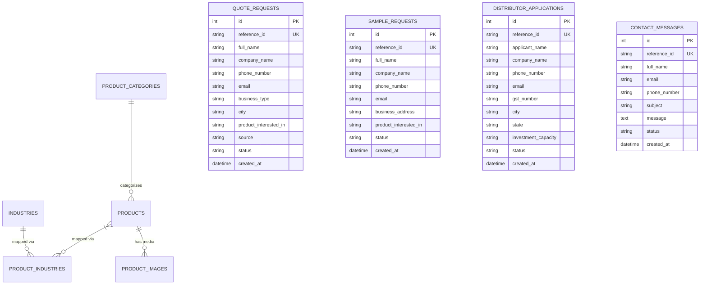

# 🏛️ Lioc B2B Platform — Comprehensive Architecture & Technical Blueprint

This document defines the high-level architecture, domain boundaries, data models, lead processing pipelines, security mechanisms, and deployment topologies for the **Lioc Full-Stack B2B Cleaning & Hygiene Digital Platform**.

---

## 1. System Architecture Topology

The platform operates as a decoupled, modern full-stack web application designed for high availability, zero latency, and seamless horizontal scaling:

```
[ Client Browsers / Mobile Devices / B2B Clients ]
                         │
                         ▼
             [ Next.js 14 Web Frontend ]
        (App Router, SSR/SSG, TypeScript, Tailwind)
                         │
             Rewrites `/api/v1/*` Proxy
                         │
                         ▼
              [ FastAPI Backend API ]
    (Python 3.12, Pydantic v2, SlowAPI Rate Limiter)
        │                 │                  │
        ▼                 ▼                  ▼
[ SQLAlchemy ORM ] [ Background Worker ] [ Cloudflare Turnstile ]
        │          (Asynchronous SMTP)   (Anti-Spam Verification)
        ▼                 │                  │
 [ SQLite / RDS ]         ▼                  ▼
  (PostgreSQL)    [ Email Dispatch ]    [ Bot Protection ]
```

---

## 2. Technology Stack & Components

### 🖥️ Frontend Layer (`frontend/`)
* **Framework:** Next.js 14 (App Router architecture with React 18, React DOM).
* **Language & Typing:** TypeScript 5.4+ (Strict typing with zero implicit `any`).
* **Styling & UI:** Tailwind CSS 3.4 with custom brand tokens (`lioc-teal`, `lioc-navy`, `lioc-emerald`), Lucide React icons.
* **Internationalization (i18n):** Client-side `LanguageContext` supporting English (`en`), Bengali (`bn`), and Hindi (`hi`) with persistent `localStorage` memory and instant zero-reload UI translation.
* **SEO & Structured Data:** Dynamic `sitemap.ts`, `robots.ts`, OpenGraph metadata, and structured `schema.org` JSON-LD for Organization, LocalBusiness, and Products.

### ⚙️ Backend API Layer (`backend/app/`)
* **Framework:** FastAPI (Python 3.12) with ASGI Uvicorn runtime.
* **Data Validation & DTOs:** Pydantic v2 schemas for strict payload validation and sanitization.
* **Persistence & ORM:** SQLAlchemy 2.0 ORM with connection pooling (`pool_size=10`, `max_overflow=20`, `pool_recycle=1800`, `pool_pre_ping=True`).
* **Database Migrations:** Alembic with version-controlled migrations and dynamic database URL resolution.
* **Security & Auth:** Stateless HS256 JWT tokens with 7-day expiration, PBKDF2-HMAC-SHA256 password hashing (100,000 iterations), SlowAPI rate limiting, and Cloudflare Turnstile bot verification.
* **Telephony & Messaging:** One-click WhatsApp URI generator pre-filling SKU, product names, and unique tracking IDs.
* **Email Worker:** Asynchronous non-blocking multi-threaded email dispatch ensuring API responses return in `<100ms` even during SMTP latency.

---

## 3. Database Schema & Data Models

The persistence layer is organized around **8 core tables**:



---

## 4. Lead Processing & Multi-Channel Notification Pipeline

When a commercial client submits an inquiry through any form, the system executes the following deterministic lifecycle:

```
[ Customer Submits Form ] 
        │
        ▼
[ Cloudflare Turnstile Anti-Spam Check ] (Returns HTTP 400 if bot)
        │
        ▼
[ Pydantic Input Validation ] (Returns HTTP 422 if invalid)
        │
        ▼
[ Generate Tracking Reference ID ] (e.g., LQ-260922-XXXXXX)
        │
        ▼
[ Persist Lead to Database (SQLAlchemy) ]
        │
        ├──► [ Return HTTP 201 JSON Response to Frontend (< 80ms) ]
        │
        └──► [ Spawn Background Email Dispatch Worker ]
                 │
                 ├──► [ Internal Sales Team Alert Email (with Lead Specs) ]
                 └──► [ Customer Confirmation Email (with Reference ID & SLA) ]
```

---

## 5. Specialized Interactive Engines

### 1. 🤖 Virtual Hygiene Auditor (`/virtual-hygiene-auditor`)
* **Algorithm:** Takes facility square footage, active operational units, restrooms count, footfall intensity, and operational challenges (e.g., marble floors, hard water, heavy grease).
* **Output:** Calculates monthly concentrate volume (Litres), ready-to-use solution yield at dilution, ROI cost comparison (Retail vs. Lioc Factory Wholesale), annual financial savings, and multi-shift Housekeeping Standard Operating Procedures (SOPs).

### 2. 🔍 Interactive Product Finder (`/product-finder`)
* **Algorithm:** 3-step decision wizard mapping sector requirements (e.g., Hotels, Food Service, Healthcare) and surface constraints (e.g., stone care, degreasing) to high-potency chemical formulations with confidence scoring.

### 3. 💬 AI Chemical Support Assistant (`AskChemistWidget`)
* **Engine:** Dual-cloud LLM architecture (Google Gemini 1.5 Flash / OpenAI GPT-4o-mini) paired with a high-precision local grounded semantic knowledge base covering surface safety SOPs (marble protection, drain declogging, air care, hospital sanitization).

---

## 6. Security & Hardening Boundaries

| Layer | Security Control | Enforcement Mechanism |
| :--- | :--- | :--- |
| **Authentication** | CEO & Admin Login | PBKDF2-HMAC-SHA256 password hash + Stateless HS256 JWT Bearer tokens with 7-day TTL. |
| **Rate Limiting** | Brute-force & Abuse Protection | SlowAPI in-memory limiter: `5/min` for `/admin/login`, `5/10min` for public lead forms. |
| **Anti-Spam** | Bot Form Flooding | Cloudflare Turnstile cryptographic token verification on all POST routes. |
| **CORS** | Cross-Origin Request Restriction | Origin whitelist restricted via `BACKEND_CORS_ORIGINS` (explicitly disallows wildcard `*` with credentials). |
| **Production Secrets** | Zero Leakage Guarantee | Environment variable isolation in `.env`, production validation check at `lifespan` startup. |
| **Error Handling** | Information Disclosure Prevention | Global exception handlers sanitize internal stack traces in production (`DEBUG=False`). |

---

## 7. Directory Structure & File Map

```text
LIOC-WEBSITE/
├── .env.example                     # Environment template
├── .gitignore                       # Git exclusion rules
├── README.md                        # Master repository documentation
├── alembic.ini                      # Root Alembic migration configuration
├── docker-compose.yml               # Multi-container deployment
├── pyproject.toml                   # Python toolchain (pytest, ruff, black)
├── docs/                            # Operational documentation & runbooks
│   ├── ARCHITECTURE.md              # System design & architecture blueprint
│   ├── BACKUP_AND_RECOVERY.md       # Backup & recovery procedures
│   ├── PRODUCTION_CHECKLIST.md      # Launch readiness checklist
│   └── STAGING_VERIFICATION.md      # Verification matrix
├── scripts/                         # Operational CLI scripts
│   ├── generate_password_hash.py    # Admin password hash generator
│   └── view_leads.py                # Lead inspection & CSV export utility
├── backend/                         # FastAPI Application Service
│   ├── Dockerfile                   # Container definition
│   ├── alembic.ini                  # Backend Alembic configuration
│   ├── requirements.txt             # Python dependencies
│   ├── alembic/                     # Migrations & revisions
│   ├── app/
│   │   ├── main.py                  # App entry point
│   │   ├── api/v1/routes/           # Modular domain endpoints
│   │   ├── core/                    # Config, security, rate limit & logging
│   │   ├── database/                # Engine, session & seeder
│   │   ├── middleware/              # Request ID & timing middleware
│   │   ├── models/                  # SQLAlchemy ORM models
│   │   ├── repositories/            # Data access layer
│   │   ├── schemas/                 # Pydantic validation schemas
│   │   └── services/                # Business logic services
│   └── tests/                       # Modular Pytest test suite
│       ├── conftest.py              # Shared fixtures
│       ├── test_admin.py            # Admin auth & pipeline tests
│       ├── test_assistant.py        # AI chat assistant tests
│       ├── test_auditor.py          # Virtual Hygiene Auditor tests
│       ├── test_catalog.py          # Product catalog tests
│       ├── test_health.py           # Heartbeat & middleware tests
│       ├── test_leads.py            # Lead submission & anti-spam tests
│       └── test_product_finder.py   # Product finder algorithm tests
└── frontend/                        # Next.js 14 App Router UI
    ├── Dockerfile                   # Container definition
    ├── next.config.js               # Next.js configuration & API rewrites
    ├── package.json                 # Node dependencies
    ├── tailwind.config.js           # Brand design system
    ├── tsconfig.json                # TypeScript compiler config
    ├── .eslintrc.json               # ESLint rules
    ├── .prettierrc                  # Prettier formatting rules
    ├── app/                         # Pages & routes
    ├── components/                  # UI & domain components
    ├── lib/                         # API client, config, i18n & utilities
    └── types/                       # TypeScript interfaces
```
